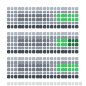
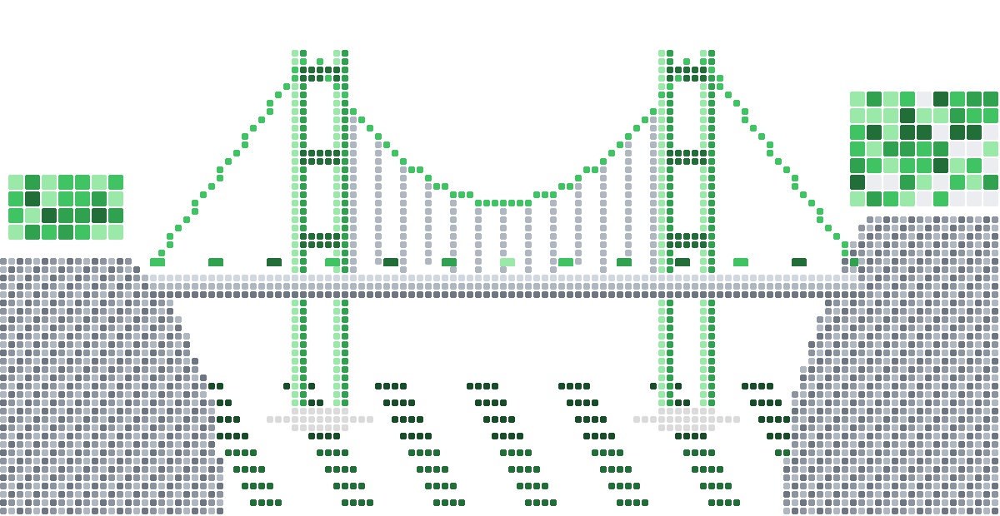
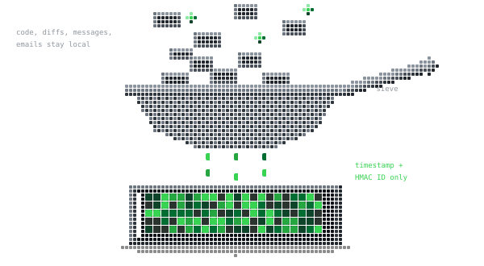
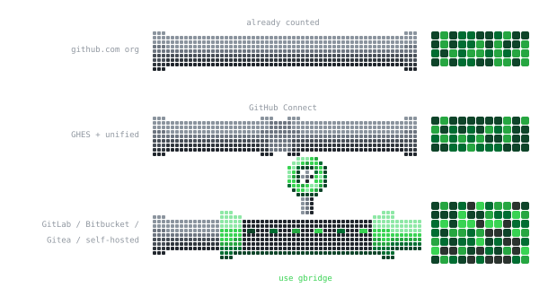
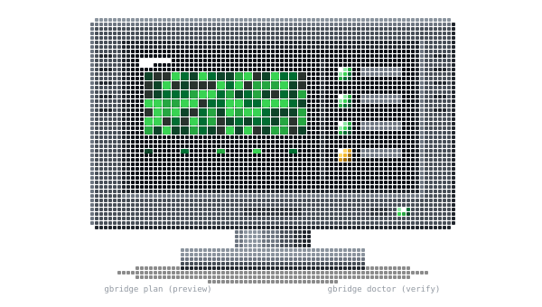
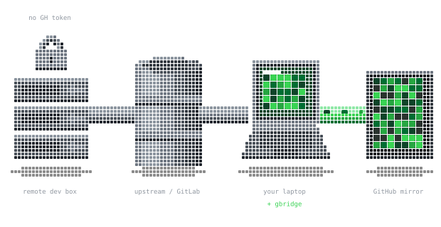

<h1 align="center">
  <picture>
    <source media="(prefers-color-scheme: dark)" srcset=".github/assets/hero-dark.svg">
    
  </picture>
</h1>

<p align="center"><b>Show GitLab, Bitbucket, Gitea, Forgejo, and self-hosted git commits on your GitHub contribution graph.</b><br>Private work commits become green squares. No code leaves your machine.</p>

<p align="center">
  <a href="https://github.com/sorfeb/greenbridge/actions/workflows/ci.yml"></a>
  <a href="https://github.com/sorfeb/greenbridge/releases/latest"></a>
  <a href="https://pkg.go.dev/github.com/sorfeb/greenbridge"></a>
  <a href="https://goreportcard.com/report/github.com/sorfeb/greenbridge"></a>
  <a href="LICENSE"></a>
</p>

GitHub only counts commits it hosts. `gbridge` reads commit metadata from your local clones and writes one empty, backdated commit per commit you authored to a private mirror repo you own.

```sh
go install github.com/sorfeb/greenbridge/cmd/gbridge@latest   # or download a release; see Install
gbridge init --email you@work.com --scan ~/work               # private mirror repo; ~/work rescanned every run
gbridge plan                                                  # preview, writes nothing; then gbridge sync
```

<p align="center">
  <picture><source media="(prefers-color-scheme: dark)" srcset=".github/assets/forge-gitlab-dark.svg"></picture>
  <picture><source media="(prefers-color-scheme: dark)" srcset=".github/assets/forge-bitbucket-dark.svg"></picture>
  <picture><source media="(prefers-color-scheme: dark)" srcset=".github/assets/forge-gitea-dark.svg"></picture>
  <picture><source media="(prefers-color-scheme: dark)" srcset=".github/assets/forge-forgejo-dark.svg"></picture>
  <picture><source media="(prefers-color-scheme: dark)" srcset=".github/assets/forge-codeberg-dark.svg"></picture>
  <picture><source media="(prefers-color-scheme: dark)" srcset=".github/assets/forge-git-dark.svg"></picture>
  <picture><source media="(prefers-color-scheme: dark)" srcset=".github/assets/forge-self-hosted-dark.svg"></picture>
</p>

<p align="center">Works with GitLab, Bitbucket, Gitea, Forgejo, Codeberg, and any server you can <code>git clone</code> from.</p>

<picture>
  <source media="(prefers-color-scheme: dark)" srcset=".github/assets/how-bridge-dark.gif">
  
</picture>

<picture>
  <source media="(prefers-color-scheme: dark)" srcset=".github/assets/proof-dark.svg">
  
</picture>

### Real account, real numbers

The maintainer's own graph (12 months to 2026-11-02; 2,292 commits mirrored from non-GitHub forges):

| | Before | After `gbridge sync` |
|---|---|---|
| Contributions, 12 months | 6,994 | 9,268 (+33%) |
| Contributions, last 9 weeks | 1,799 | 4,073 (2.3x) |
| Active days, last 9 weeks | 57 of 63 | 63 of 63 |
| Longest streak | 82 days | 95 days |

## Security



Only two fields leave your machine per commit:

- **Timestamp** — exact for a private mirror, date-only for a public one.
- **Opaque 12-char ID** — `HMAC(secret, email NUL author_unix)`. Without your local secret, nobody can link a mirror ID back to a source commit.

Back up your recovery phrase with `gbridge secret`: losing it means the next sync can't recognize already-mirrored commits and will double-count. Check your employment contract before mirroring employer work.

## Do you need this?



- **github.com org:** Already counted. Turn on **Include private contributions on my profile** at <https://github.com/settings/profile> and verify your work email.
- **GitHub Enterprise Server + unified contributions:** Link accounts via GitHub Connect ([docs](https://docs.github.com/en/enterprise-server@latest/account-and-profile/how-tos/contribution-settings/sharing-contributions-from-github-enterprise-server)).
- **Everything else:** Use `gbridge`. It mirrors real commits 1:1 on their original author date—never fabricates activity or pads streaks—staying within GitHub's [acceptable use policy](https://docs.github.com/en/site-policy/acceptable-use-policies/github-acceptable-use-policies#4-spam-and-inauthentic-activity-on-github).

## Install

Requires `git` and the [GitHub CLI](https://cli.github.com) logged in (`gh auth login`).

```sh
mise use -g github:sorfeb/greenbridge                          # mise (requires v0.1.0+)
go install github.com/sorfeb/greenbridge/cmd/gbridge@latest    # Go 1.27+
```

Or download a platform archive from [Releases](https://github.com/sorfeb/greenbridge/releases) and put `gbridge` on your `PATH`. The binary is named `gbridge` (not `gb`, which oh-my-zsh/prezto alias to `git branch`).

<details>
<summary>Verify a download (checksums, SBOM, provenance attestation)</summary>

```sh
gh attestation verify gbridge_<version>_linux_amd64.tar.gz --repo sorfeb/greenbridge
```

</details>

<details>
<summary>First run on macOS and Windows (unsigned release binaries)</summary>

- **macOS:** `xattr -d com.apple.quarantine gbridge` (or **System Settings > Privacy & Security > Open Anyway**).
- **Windows:** SmartScreen -> **More info** -> **Run anyway**.

`go install` and `mise` builds don't trigger these prompts.

</details>

## Usage



```sh
gbridge init --email you@work.com --scan ~/work   # create private greenbridge-activity repo
gbridge plan                                      # preview, writes nothing
gbridge sync                                      # mirror and push; rerun any time
gbridge doctor                                    # explain missing squares
```

| Command | Does | Key flags |
|---|---|---|
| `gbridge init` | Configure emails, repos, scan folders, secret, and mirror | `--email`, `--repo`, `--scan`, `--mirror`, `--public`, `--local-only`, `--secret` |
| `gbridge add` / `remove` | Edit `email`, `repo`, or `scan` in config without touching secret/mirror | `gbridge add scan ~/work` |
| `gbridge config` | Print current setup (never prints secret) | |
| `gbridge plan` | Preview counts per year and a terminal graph | `--since YYYY-MM-DD`, `--offline` |
| `gbridge sync` | Mirror missing commits and push (~0.5 s local, 3–6 s with GitHub) | `--since`, `--dry-run`, `--no-push` |
| `gbridge backfill` | Alias for `sync` | `--since` |
| `gbridge doctor` | Verify GitHub's contribution rules and suggest unconfigured emails | |
| `gbridge secret` | Print recovery phrase for a second machine | |
| `gbridge completion` | Print tab-completion script | `bash`, `zsh`, `fish`, `powershell` |

- **Stateless & safe to rerun:** `sync` reads already-mirrored IDs from the mirror's git log. Past work is recovered on the first run.
- **Private mirror visibility:** Turn on **Include private contributions on my profile** at <https://github.com/settings/profile> (`doctor` flags this as unverified since no GitHub API exposes it).
- **Override config dir:** Set `GBRIDGE_HOME`.

## Guides

### Work on a remote dev box



Keep GitHub credentials off shared machines:
1. On the remote box, `git push` to upstream before stopping work.
2. On your laptop, run `git fetch --all` in your clones, then `gbridge sync`.

### Multi-machine sync

Run `gbridge secret` on machine 1, then `gbridge init --secret <phrase>` on machine 2. A different secret produces different IDs and double-counts.

### Edit config & tab completion

```sh
gbridge add scan ~/work                 # rescanned on every plan and sync
gbridge add email old@laptop.example    # add another work email
gbridge add repo ~/code/api             # track one repo explicitly
gbridge remove repo ~/code/api          # works even after the clone is deleted
```

<details>
<summary>Shell tab completion</summary>

| Shell | Setup |
|---|---|
| bash | `source <(gbridge completion bash)` in `~/.bashrc` |
| zsh | `source <(gbridge completion zsh)` in `~/.zshrc` (after `compinit`) |
| fish | `gbridge completion fish > ~/.config/fish/completions/gbridge.fish` |
| PowerShell | `gbridge completion powershell \| Out-String \| Invoke-Expression` in `$PROFILE` |

</details>

## What counts & limitations

A commit is mirrored when: its author email is configured, it is reachable from any branch or tag in a tracked clone, and its repo has no `github.com` remote (override with `--include-github`).

| | GitHub (github.com repos) | `gbridge` |
|---|---|---|
| Branches | Default branch only | Every branch, merged or not |
| Merge commits | Counted | Counted |
| Date used | Author date, commit's time zone | Same |
| PRs, issues, reviews | Counted | Not mirrored (not in git history) |

**Limitations:** Clones only (`git fetch --all` first) · Sync is append-only (removal requires rebuilding + force-pushing the mirror) · One mirror per config · Two commits by one email in the exact same second collapse to one ID · No automatic pre-push hook yet.

## Alternatives

Checked 2026-10-26 from each project's README; rebase dedup tested in [issue #25](https://github.com/sorfeb/greenbridge/issues/25#issuecomment-6415125896).

| Tool | Reads | Needs | Mirror receives | Survives rebase | Notes |
|---|---|---|---|---|---|
| `gbridge` | Local clones, any host | git; `gh` unless `--local-only` | Timestamp + opaque ID | Yes (tested) | `plan` preview, `doctor` diagnostics. Commits only |
| [greens](https://github.com/yuvrajangadsingh/greens) | Local clones, any host | bash, git; optional `gh` | Timestamp; optional subjects & repo dashboard | Yes (tested) | Optional PR/issue timestamps. Windows beta |
| [import-gitlab-commits](https://github.com/alexandear/import-gitlab-commits) | GitLab API | Go/Docker; GitLab token | Project ID + source commit hash | Not tested | GitLab only |
| [Contributions Importer](https://github.com/miromannino/Contributions-Importer-For-Github) | Local repos or CSV | Python | Mock code files + messages | Not tested | CSV mode creates commits from counts |
| [carboncopy](https://github.com/gcrevell/carboncopy) | Gitea API | bash, curl, jq; Gitea token | Timestamp + hashed ledger | No (tested) | Gitea only |

## FAQ

<details>
<summary>What happens when I rebase, cherry-pick, amend, or squash?</summary>

Rebase, cherry-pick, and amend preserve the author date, so the commit keeps the same HMAC ID and counts once. A squash merge creates a new commit with a new author date, so it mirrors alongside the original branch commits while they remain in your clone.

</details>

<details>
<summary>Why aren't my commits showing as green squares yet?</summary>

Run `gbridge doctor`. GitHub requires: default branch of a non-fork repo, verified author email, and **Include private contributions on my profile** enabled for private mirrors. GitHub's graph can take up to 24 hours to update.

</details>

<details>
<summary><code>gbridge doctor</code> flagged an email missing from config. Should I add it?</summary>

Run the `gbridge add email <address>` command it prints, then `gbridge plan`. `doctor` automatically skips emails shared with other author names so you don't accidentally mirror a coworker's commits.

</details>

## Contributing & License

Issues and bug reports: [GitHub issues](https://github.com/sorfeb/greenbridge/issues) · Security: [SECURITY.md](SECURITY.md) · Dev guide: [CONTRIBUTING.md](CONTRIBUTING.md).

```sh
go tool -modfile tools.mod task check   # what CI runs
go tool -modfile tools.mod task fix     # auto-fix lint and formatting
```

[MIT](LICENSE)
