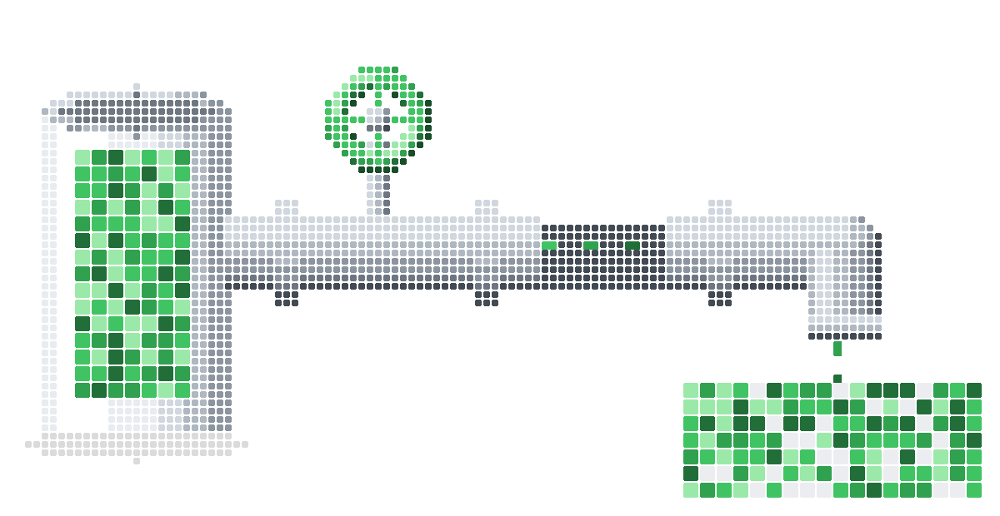
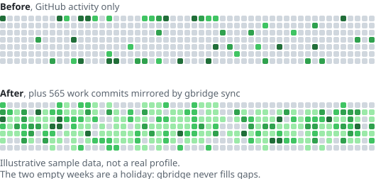

<h1 align="center">
  <picture>
    <source media="(prefers-color-scheme: dark)" srcset=".github/assets/hero-dark.svg">
    
  </picture>
</h1>

<p align="center">Mirror commits GitHub can't see onto your GitHub contribution graph, without copying any code.</p>

<p align="center">
  <a href="https://github.com/sorfeb/greenbridge/actions/workflows/ci.yml"></a>
  <a href="https://github.com/sorfeb/greenbridge/releases/latest"></a>
  <a href="https://pkg.go.dev/github.com/sorfeb/greenbridge"></a>
  <a href="https://goreportcard.com/report/github.com/sorfeb/greenbridge"></a>
  <a href="LICENSE"></a>
</p>

Work on an employer GitLab, Bitbucket, a self-hosted Gitea or Forgejo, or an on-prem server never reaches your GitHub contribution graph. `gbridge` reads commit metadata from your local clones and writes one empty, backdated commit per real commit to a private mirror repo you own. GitHub then counts those commits like any other, and the green squares appear.

<!-- Preview for review: keep pipe or bridge, drop the other. -->

<picture>
  <source media="(prefers-color-scheme: dark)" srcset=".github/assets/how-pipe-dark.gif">
  
</picture>

<picture>
  <source media="(prefers-color-scheme: dark)" srcset=".github/assets/how-bridge-dark.gif">
  
</picture>

```sh
go install github.com/sorfeb/greenbridge/cmd/gbridge@latest   # or download a release; see Install
gbridge init --email you@work.com --scan ~/work               # creates a private mirror repo
gbridge plan                                                  # preview, writes nothing; then gbridge sync
```

<picture>
  <source media="(prefers-color-scheme: dark)" srcset=".github/assets/proof-dark.svg">
  
</picture>

## Table of contents

- [Security](#security)
- [Background](#background)
- [Do you need this?](#do-you-need-this)
- [Install](#install)
- [Usage](#usage)
- [What counts](#what-counts)
- [Keeping the graph current](#keeping-the-graph-current)
- [Alternatives](#alternatives)
- [Limitations](#limitations)
- [FAQ](#faq)
- [Contributing](#contributing)
- [License](#license)

## Security

Per source commit, only two things leave your machine:

- a timestamp, exact for a private mirror and date only for a public one
- an opaque 12-character ID, `HMAC(secret, email NUL author_unix)`

Code, diffs, file names, commit messages, repo and branch names, commit hashes, and your work email stay local. Without the secret, nobody can match a mirror ID to a source commit, including people with access to the source repo.

The secret lives in your config directory. Back up the phrase from `gbridge secret`: losing it means the next sync can't recognise what is already mirrored, and double counts.

## Background

GitHub counts a commit when it is on the default branch of a non-fork repo and its author email belongs to your account ([reference](https://docs.github.com/en/account-and-profile/reference/profile-contributions-reference)). Commits are placed on the day of their author date, in the commit's own time zone. An empty commit counts the same as any other.

`gbridge` uses exactly that: it never fabricates activity, only mirrors commits you wrote, one to one, at the time you wrote them. Tools that paint patterns or pad streaks break GitHub's [acceptable use policy](https://docs.github.com/en/site-policy/acceptable-use-policies/github-acceptable-use-policies#4-spam-and-inauthentic-activity-on-github) on inauthentic activity. `gbridge` is designed to stay on the right side of it.

Check your employment contract before mirroring employer work. Only timestamps leave your machine, but some employers treat even those as internal.

## Do you need this?

Maybe not. Skip `gbridge` when either of these is true:

- **Your employer's code is in an organization on github.com.** GitHub already counts those commits. For private repos, turn on **Include private contributions on my profile** at <https://github.com/settings/profile> and make sure your work email is on your account.
- **Your employer runs GitHub Enterprise Server with unified contributions.** An enterprise owner enables it through GitHub Connect, and each user links their accounts. GitHub then sends anonymized contribution counts to your github.com graph. Ask your administrator. See [Sharing contributions from GitHub Enterprise Server](https://docs.github.com/en/enterprise-server@latest/account-and-profile/how-tos/contribution-settings/sharing-contributions-from-github-enterprise-server).

Use `gbridge` when your work is on GitLab, Bitbucket, Gitea, Forgejo, or any other host that gives you git clones, or on GitHub Enterprise Server without unified contributions.

## Install

Requires `git` and the [GitHub CLI](https://cli.github.com) logged in (`gh auth login`).

Pick one:

```sh
mise use -g github:sorfeb/greenbridge                          # mise, from the GitHub release
go install github.com/sorfeb/greenbridge/cmd/gbridge@latest    # Go 1.27+
```

Or download the archive for your platform from [Releases](https://github.com/sorfeb/greenbridge/releases) and put `gbridge` on your `PATH`.

While this repo is private, set `GOPRIVATE=github.com/sorfeb/*` first, or run `go install ./cmd/gbridge` from a clone.

The command is `gbridge`, not `gb`: oh-my-zsh and prezto alias `gb` to `git branch`.

### Verify a download

Each release ships `checksums.txt`, an SBOM per archive, and a GitHub build provenance attestation. To confirm an archive was built by this repo's release workflow and not uploaded by hand:

```sh
gh attestation verify gbridge_<version>_linux_amd64.tar.gz --repo sorfeb/greenbridge
```

## Usage

```sh
gbridge init --email you@work.com --scan ~/work   # create a private greenbridge-activity repo
gbridge plan                                      # preview, writes nothing
gbridge sync                                      # mirror and push; rerun any time
gbridge doctor                                    # explain missing squares
```

### CLI

| Command | Does | Useful flags |
|---|---|---|
| `gbridge init` | Sets up emails, source repos, the secret, and the mirror repo | `--email`, `--repo`, `--scan` (repeatable), `--mirror`, `--public`, `--local-only`, `--secret` |
| `gbridge plan` | Previews counts per year and a terminal graph | `--since YYYY-MM-DD`, `--offline` |
| `gbridge sync` | Adds missing commits to the mirror and pushes | `--since`, `--dry-run`, `--no-push` |
| `gbridge backfill` | Alias for `sync`, for recovering past work | `--since` |
| `gbridge doctor` | Checks every condition GitHub needs to show a square | |
| `gbridge secret` | Prints the recovery phrase for a second machine | |
| `gbridge completion` | Prints a tab-completion script | `bash`, `zsh`, `fish`, `powershell` |

- **Past work** is recovered on the first sync, as far back as your clones go.
- **Reruns are safe.** `gbridge sync` reads already-synced IDs back from the mirror's log. There is no state file.
- **Several machines** can sync into one mirror. Run `gbridge secret` on the first, then `gbridge init --secret <phrase>` on the second. A different secret produces different IDs and double counts.
- **Private mirror:** turn on **Include private contributions on my profile** at <https://github.com/settings/profile>. `gbridge doctor` reports this setting as unverified, since no GitHub API exposes it.
- `GBRIDGE_HOME` overrides the config directory.

### Tab completion

Completes commands, each command's flags, and directories after `--repo` and `--scan`. Add one line for your shell:

| Shell | Add |
|---|---|
| bash | `source <(gbridge completion bash)` to `~/.bashrc` |
| zsh | `source <(gbridge completion zsh)` to `~/.zshrc`, after `compinit` |
| fish | Run once: `gbridge completion fish > ~/.config/fish/completions/gbridge.fish` |
| PowerShell | `gbridge completion powershell \| Out-String \| Invoke-Expression` to `$PROFILE` |

Release archives also include the four scripts under `completions/`.

## What counts

`gbridge` mirrors a commit when all of these hold:

- Its author email is one you gave `gbridge init`.
- It is reachable from any local branch, remote-tracking branch, or tag in a source clone.
- Its repo has no github.com remote, since GitHub already counts those. Override at init with `--include-github`.

Duplicates collapse: a rebased, cherry-picked, or amended commit keeps its author email and date, so it maps to the same ID and counts once. Tested against all three in [issue #25](https://github.com/sorfeb/greenbridge/issues/25#issuecomment-6415125896). Two different commits by one email in the same second also collapse to one ID.

### How this differs from GitHub

| | GitHub, for github.com repos | `gbridge` today |
|---|---|---|
| Branches | Default branch only; feature work appears once merged | Every branch, merged or not |
| Merge commits | Counted | Counted |
| Date used | Author date, commit's own time zone | Same |
| Pull requests, issues, reviews | One contribution each | Not mirrored; git history doesn't record them |

## Keeping the graph current

There is no automatic trigger yet. Run `gbridge sync` after you push.

A local sync costs about 0.5 s. Network round trips to GitHub (check the mirror, fetch, push) add 3-6 s. The planned pre-push hook will only queue a request and start a detached `gbridge sync`, so it adds milliseconds to your push and never blocks or fails it.

## Alternatives

Other tools solve the same problem. Pick by where your code lives and what you accept in the mirror. Facts come from each project's README, checked on 2026-10-26. For greens and carboncopy, the dedup column comes from running them against a rebased, cherry-picked, and amended history ([issue #25](https://github.com/sorfeb/greenbridge/issues/25#issuecomment-6415125896)). Open an issue if a row is out of date.

| | Reads | Needs | Mirror receives | Survives rebase | Notes |
|---|---|---|---|---|---|
| `gbridge` | Local clones, any host | git; `gh` unless `--local-only` | Timestamp and an opaque ID | Yes (tested) | `plan` previews, `doctor` explains missing squares. Commits only |
| [greens](https://github.com/yuvrajangadsingh/greens) | Local clones, any host | bash, git; optional `gh` | Timestamp; optional commit subjects; repo-name dashboard on a verified private mirror | Yes, by timestamp (tested) | Also mirrors PR and issue timestamps, opt in. Windows is beta |
| [alexandear/import-gitlab-commits](https://github.com/alexandear/import-gitlab-commits) | GitLab API | Go or Docker; GitLab token with `read_api`, `read_user`, `read_repository` | Project ID and source commit hash in each message | Not tested | GitLab only. Ships before and after screenshots |
| [Contributions Importer](https://github.com/miromannino/Contributions-Importer-For-Github) | Local repos, or a CSV of counts | Python (pip or brew) | Mock code files, mock or kept messages | Not tested | Its CSV mode creates commits from counts you supply. `gbridge` has no such mode |
| [carboncopy](https://github.com/gcrevell/carboncopy) | Gitea API, default branch | bash, curl, jq; Gitea token | Timestamp; ledger of hashed repo and commit | No: a rewritten commit is copied again (tested) | Gitea only |

`gbridge` is not the only tool that survives a rebase. What it adds is local-first credentials (no host token), a preview before anything is published, and no commit hash, message, or repo name in the mirror. It is younger than the others and mirrors fewer activity types.

## Limitations

- **Clones only.** Commits that never reached a local clone are invisible. Run `git fetch --all` before syncing.
- **Removal is manual.** Sync only adds. Removing mirrored commits means rebuilding the mirror and force-pushing it.
- **One mirror per config.** Splitting activity per employer isn't supported yet.
- **Commits only.** Pull requests, issues, and reviews are not mirrored.
- **Same-second commits collapse.** Two commits by one email with the same author second count once.

## FAQ

### How do I show GitLab contributions on my GitHub profile?

Run `gbridge init --email you@work.com --scan ~/work`, then `gbridge plan` and `gbridge sync`. `gbridge` reads your local GitLab clones and writes one empty, backdated commit per commit you authored to a private mirror repo on your account. Turn on private contributions in your profile settings so the squares show. See [Install](#install) and [Usage](#usage).

### How do I show private work commits on my GitHub contribution graph?

If the work is on github.com, you don't need `gbridge`: turn on **Include private contributions on my profile**. If it is on another host, mirror it with `gbridge`, then turn on the same setting. `gbridge doctor` reports that setting as unverified, since no GitHub API exposes it.

### Can I show Bitbucket, Gitea, or Forgejo commits on GitHub?

Yes. `gbridge` reads local git clones, so the host doesn't matter.

### Why aren't my commits showing as green squares?

Run `gbridge doctor`. GitHub counts a commit only when all of these hold:

- It is on the default branch of a repo that is not a fork.
- Its author email is verified on your account.
- For a private repo, **Include private contributions on my profile** is on.

The graph can take up to 24 hours to update after a push.

### Does it copy my code or commit messages?

No. Per commit, only a timestamp and an opaque 12-character ID leave your machine. See [Security](#security).

### Is mirroring work commits allowed by GitHub?

`gbridge` mirrors commits you wrote, one to one, at the time you wrote them. It never fills gaps or pads streaks, which is what GitHub's [acceptable use policy](https://docs.github.com/en/site-policy/acceptable-use-policies/github-acceptable-use-policies#4-spam-and-inauthentic-activity-on-github) targets. Check your employment contract first; see [Background](#background).

### What happens when I rebase, cherry-pick, or squash?

Rebase, cherry-pick, and amend keep the author date, so the commit keeps its ID and counts once. A squash merge creates a new commit with its own author date. `gbridge` mirrors it alongside the branch commits it replaced for as long as your clone still has them.

## Contributing

Questions and bug reports go to [GitHub issues](https://github.com/sorfeb/greenbridge/issues); security reports go through [SECURITY.md](SECURITY.md). See [CONTRIBUTING.md](CONTRIBUTING.md) for setup and conventions. In short, with Go 1.27 and nothing else installed:

```sh
go tool -modfile tools.mod task check   # what CI runs
go tool -modfile tools.mod task fix     # auto-fix lint and formatting
```

## License

[MIT](LICENSE)
